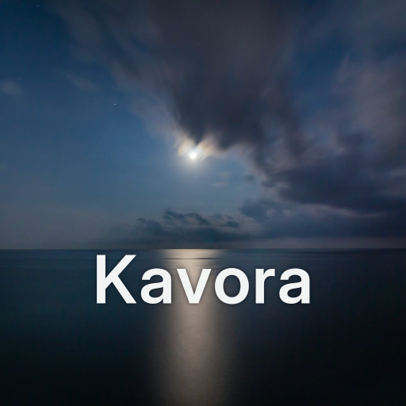
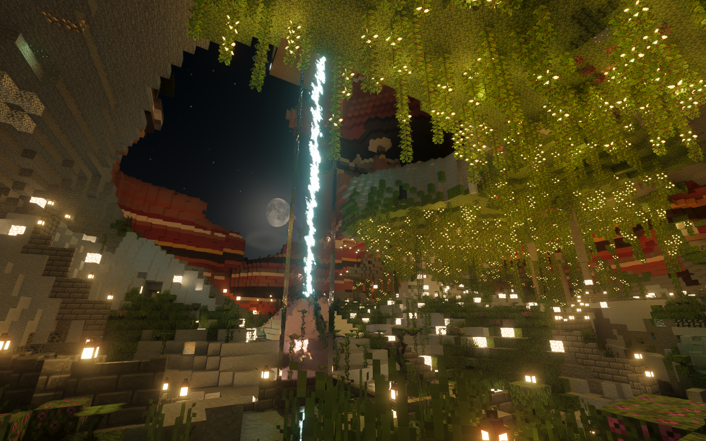
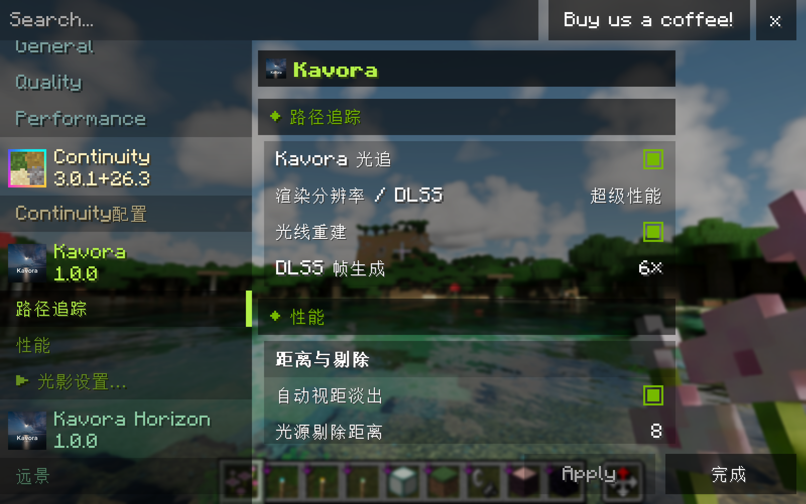
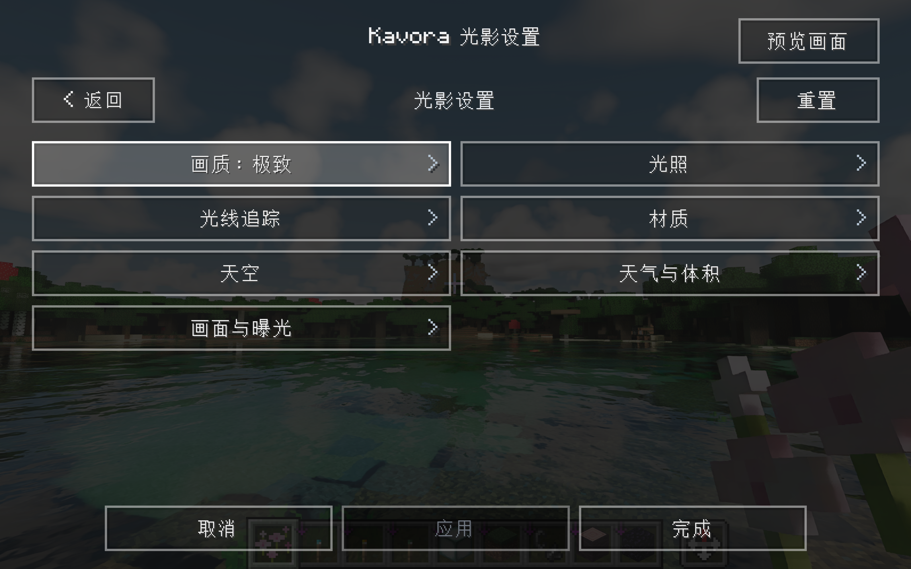
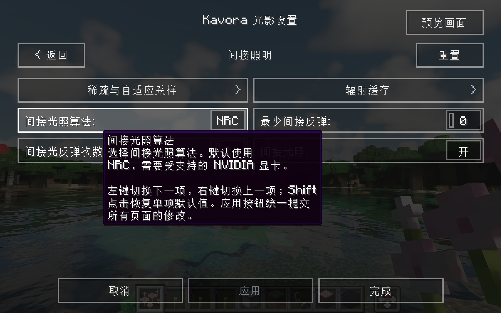
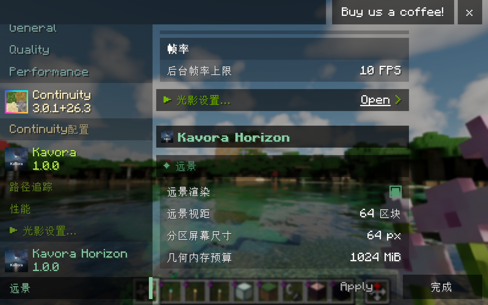
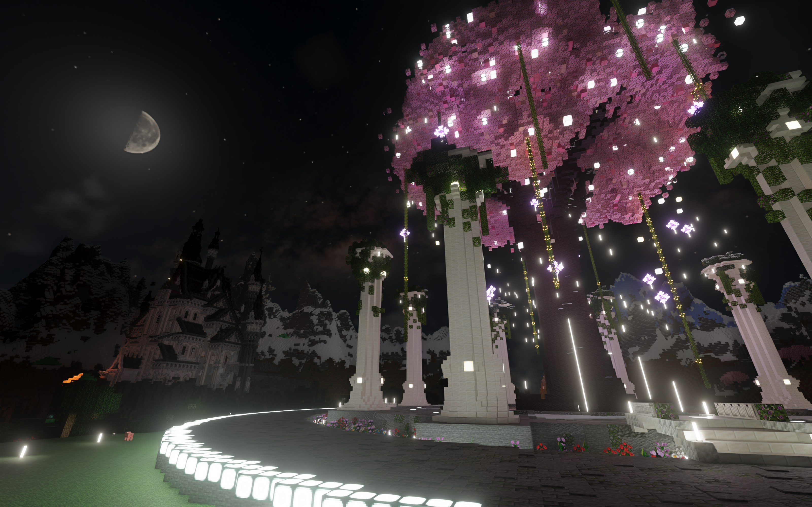
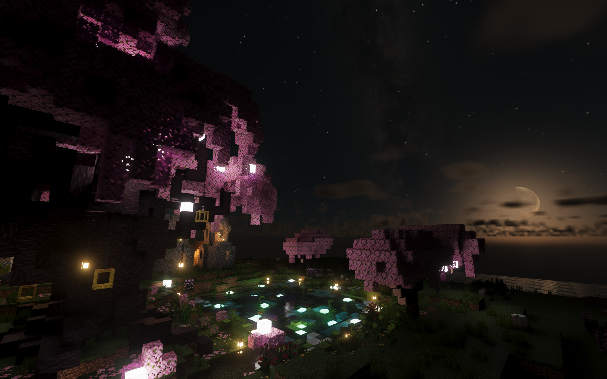
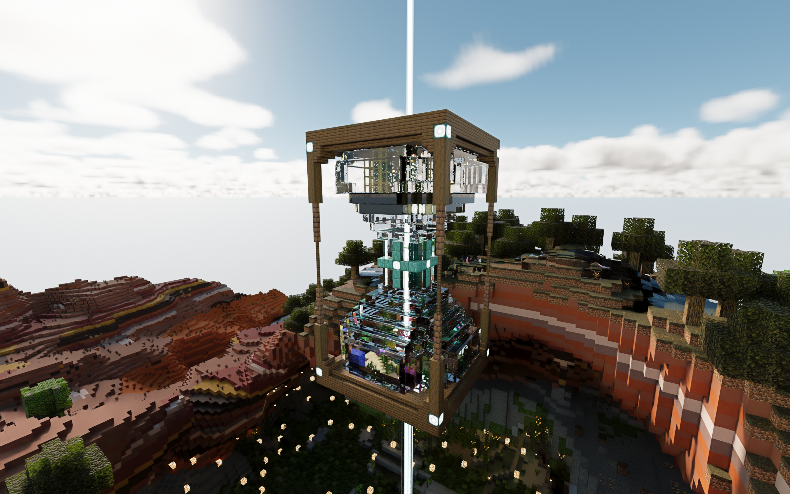
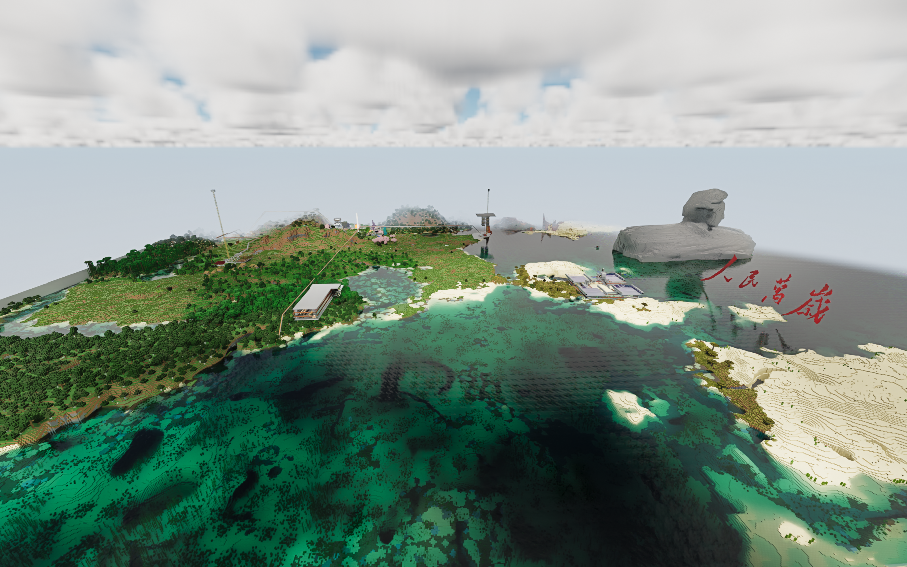

  

Real-time path tracing for Minecraft 26.3 Fabric.

<strong>English</strong> | <a href="README_zh.md">简体中文</a>

Kavora brings hardware-accelerated path tracing to Minecraft through Vulkan and NVIDIA RTX Remix. The optional **Kavora Horizon** add-on extends the view with distant terrain rendered in the same scene.

Kavora is an independent community project. It is not affiliated with NVIDIA, Mojang or Microsoft, and is not an official Minecraft product.

## Features

- Path-traced lighting, reflections and transmission, with LabPBR resource-pack support.
- Volumetric clouds, fog and light scattering; an Overworld day and night sky, and a separate End environment.
- NRC and SHaRC indirect lighting, DLSS Super Resolution, DLAA, Ray Reconstruction and frame generation on supported hardware.
- Iris-style visual settings with editable quality presets. DLSS and frame-generation settings are independent of those presets.
- Optional **Kavora Horizon** distant terrain: caches terrain loaded by the client and renders it through the same path-tracing pipeline, without generating unexplored chunks.

## Installation

Kavora currently targets **Windows x64, Minecraft 26.3 and Java 25**. It requires an **NVIDIA RTX GPU** and **driver 616 or newer**. Frame generation requires an RTX 40- or 50-series GPU; the available multipliers depend on the GPU and runtime.

Use **Fabric Loader 0.20.1 or newer**, and place these JARs in your instance's `mods` folder:

| File | Purpose |
| --- | --- |
| `Kavora-1.0.1+mc26.3.jar` | Main mod; the release JAR includes the matching native runtime |
| Sodium 0.9.2 | Required, installed separately |
| Fabric API 0.165.0+26.3 or newer for 26.3 | Required, installed separately |
| `Kavora-horizon-1.0.1+mc26.3.jar` | Optional distant-terrain add-on |

The runtime is extracted automatically; the first launch and shader compilation can take some time. Large resource packs and long view distances increase RAM and VRAM requirements.

Kavora uses Vulkan exclusively, so some OpenGL-based mods are incompatible. It does not load Iris shader packs. Voxy is unsupported, and Kavora Horizon cannot be installed alongside Distant Horizons.

## Settings and resource packs

Kavora's settings are in Sodium's video settings. DLSS, Ray Reconstruction, frame generation and performance controls are available here; changing a visual quality preset leaves these choices intact.

Open **Shader Settings** to adjust lighting, materials, sky, clouds, fog, water and exposure. Quality tiers fill in a set of values that you can continue to edit. Editing a preset changes its label to Custom while retaining the source tier.

Indirect lighting has a substantial effect on both appearance and performance. **NRC is the default** and requires supported NVIDIA hardware. You can select **SHaRC** before entering a world if NRC is unavailable.

With **Kavora Horizon** installed, its video-settings page provides distant view distance, screen-space detail and geometry-memory controls. See the [distant-terrain guide](docs/FAR_TERRAIN.md).

Kavora includes baseline material enhancements. Install additional LabPBR packs as ordinary resource packs; user packs take priority over the built-in materials. See the [settings guide](docs/SETTINGS.md) and [resource-pack guide](docs/RESOURCE_PACKS.md) for more detail.

## License and acknowledgements

The main mod and Java SDK are primarily licensed under [Apache 2.0](LICENSE). The runtime, adapted interface and shaders, add-on, assets and bundled NVIDIA SDKs retain their respective licenses. See the [license overview](LICENSES/README.md) and [third-party notices](THIRD_PARTY_NOTICES.md) for the full scope.

Kavora builds on the work of these projects and their contributors:

- [rtx-remix-minecraft](https://github.com/NVIDIAGameWorks/rtx-remix-minecraft) — the original Minecraft integration.
- [dxvk-remix](https://github.com/NVIDIAGameWorks/dxvk-remix) — the native rendering runtime.
- [Iris](https://github.com/IrisShaders/Iris) — the adapted settings interface and widgets.
- [RTX Remix Community Edition](https://github.com/NightSightProductions/RTX-Remix-Community-Edition) — cloud, material and lighting adaptations.
- [Distant Horizons](https://gitlab.com/distant-horizons-team/distant-horizons) — the foundation of the earlier distant-terrain work.
- [Caustica-Horizon](https://github.com/West68/Caustica-Horizon) — End-sky and lunar-surface adaptations.
- [Sodium](https://github.com/CaffeineMC/sodium) — terrain meshing and video settings.

For development and build instructions, see [Contributing](CONTRIBUTING.md).

## Screenshots

