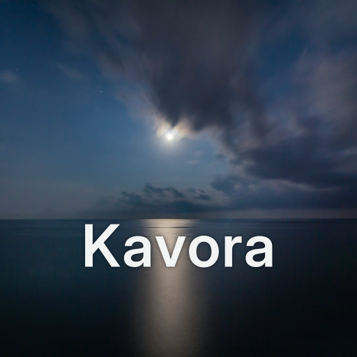
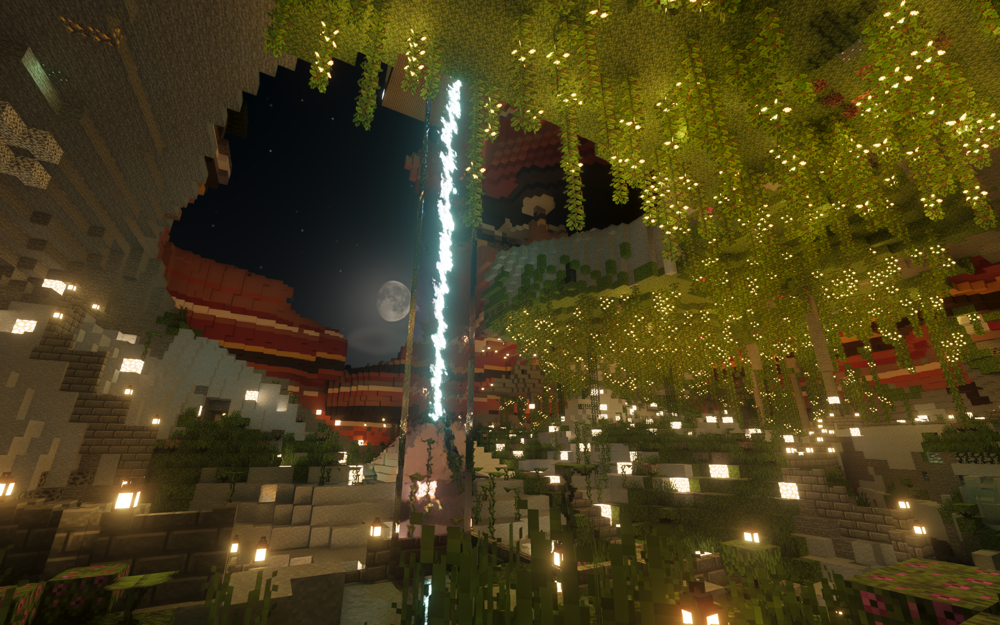
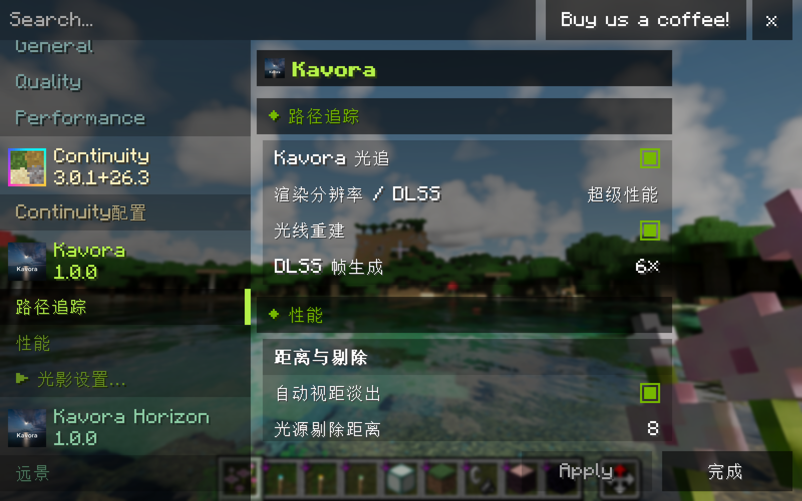
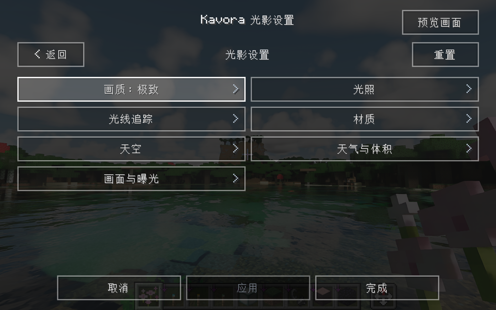
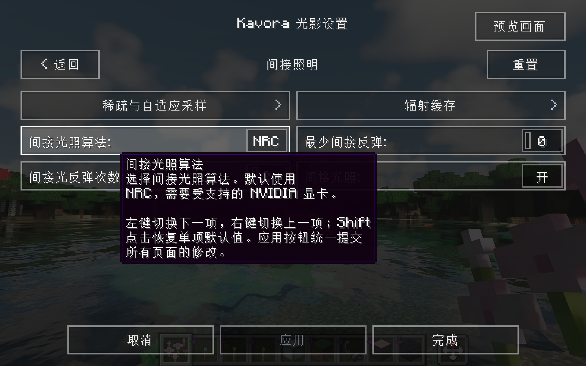
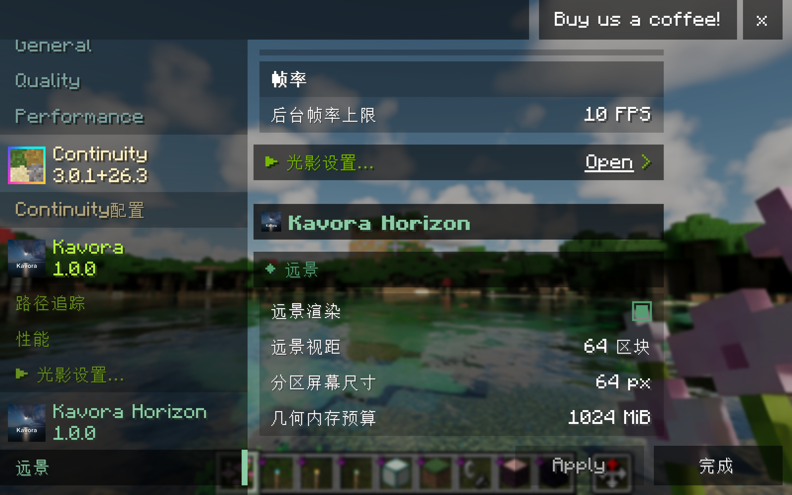
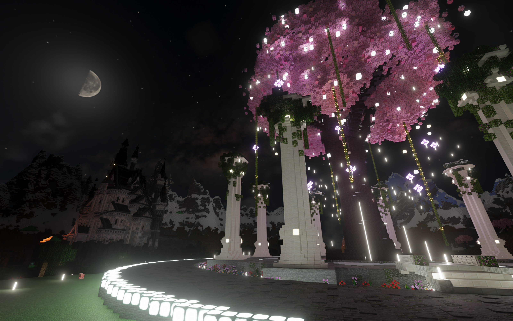
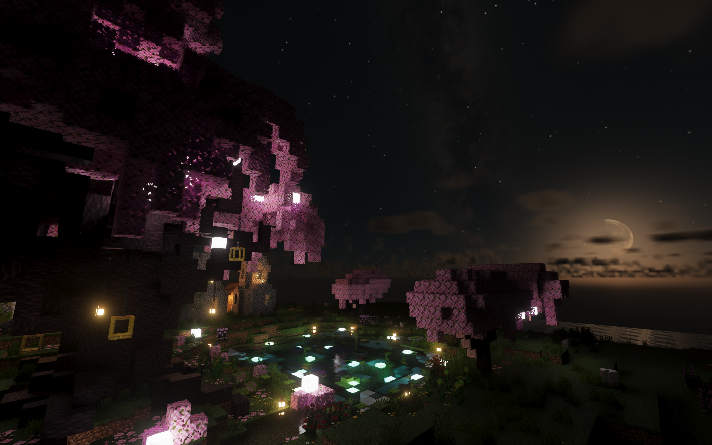
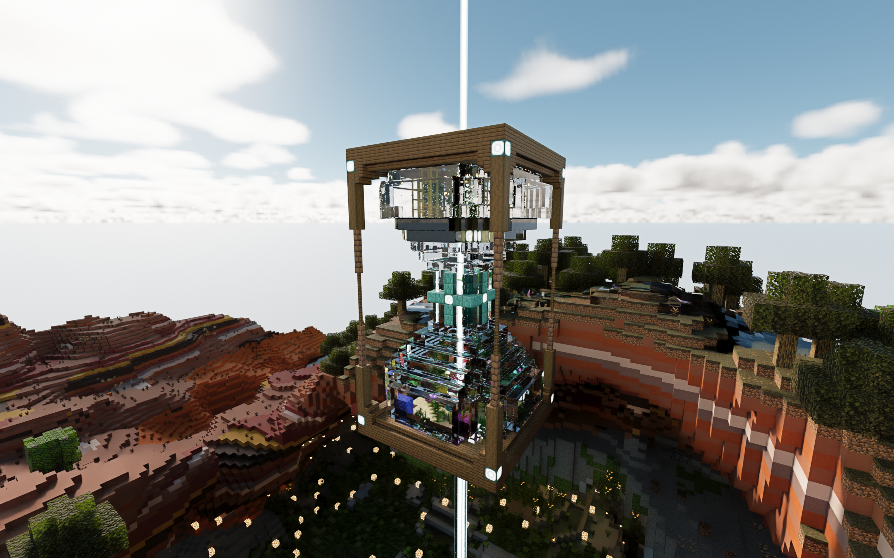
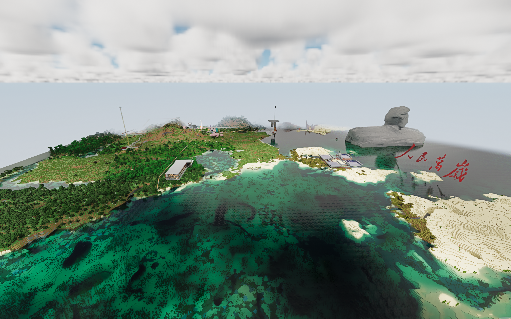

  

为 Minecraft 26.3 Fabric 引入实时路径追踪渲染。

<a href="README.md">English</a> | <strong>简体中文</strong>

Kavora 是面向 Minecraft 的渲染模组，通过 Vulkan 和 NVIDIA RTX Remix 提供硬件加速的路径追踪。可选的 **Kavora Horizon** 附加包提供 LOD 远景，让远处地形与近景在同一场景中渲染。

本项目由社区独立维护，与 NVIDIA、Mojang 和 Microsoft 没有隶属关系，也不是官方 Minecraft 产品。

## 功能

- 路径追踪光照、反射与透射，支持 LabPBR 资源包。
- 体积云、雾和光线散射；主世界昼夜天空，以及独立的末地天空。
- NRC、SHaRC 间接光照；DLSS 超分、DLAA、光线重建，以及受设备支持的帧生成。
- Iris 风格的视觉设置界面。画质档位是可编辑的参数预设，DLSS 和帧生成设置独立于画质预设。
- 可选的 **Kavora Horizon** 远景附加包，缓存客户端已加载的地形，并在同一路径追踪管线中显示，不生成未探索区块。

## 安装

目前面向 **Windows x64、Minecraft 26.3、Java 25**。需要 **NVIDIA RTX 显卡**及 **616 或更新版本的驱动**。帧生成需要 RTX 40 / 50 系列显卡，可用倍率由设备和运行时检测决定。

使用 **Fabric Loader 0.20.1 或更新版本**，在实例的 `mods` 目录放入：

| 文件 | 说明 |
| --- | --- |
| `Kavora-1.0.2+mc26.3.jar` | 主模组，发布版包含匹配的原生运行时 |
| Sodium 0.9.2 | 必需，独立安装 |
| Fabric API 0.165.0+26.3 或适用于 26.3 的更新版本 | 必需，独立安装 |
| `Kavora-horizon-1.0.2+mc26.3.jar` | 可选，远景附加包 |

首次启动会自动解压运行时，着色器编译可能需要一些时间。复杂资源包和较高的视距会增加内存与显存需求。

Kavora 仅使用 Vulkan，可能与部分基于 OpenGL 的模组不兼容。本项目不加载 Iris 光影包；Voxy 不受支持，Kavora Horizon 也不能与 Distant Horizons 同时安装。

## 设置与资源包

设置入口位于 Sodium 提供的视频设置中，可以调整 DLSS、光线重建、帧生成与性能选项。切换视觉画质预设不会改变这些设置。

进入**光影设置**后，可以调整光照、材质、天空、云、雾、水和曝光。画质档位会填入一组预设值，之后仍可逐项修改；修改后显示为自定义，并保留原档位标记。

间接光照算法会显著影响画面和性能。**默认使用 NRC**，需要受支持的 NVIDIA 显卡；若设备不支持，可以在进入世界前切换为 **SHaRC**。

安装 **Kavora Horizon** 后，可以在对应的视频设置页中调整远景视距、屏幕空间精度与几何内存预算，详见[远景说明](docs/FAR_TERRAIN.md)。

模组自带基础材质补充。额外的 LabPBR 资源包按普通资源包安装，优先级高于内置材质。更多说明见[设置指南](docs/SETTINGS.md)和[资源包指南](docs/RESOURCE_PACKS.md)。

## 许可与致谢

主模组和 Java SDK 的主体采用 [Apache 2.0](LICENSE) 许可。运行时、适配的界面与着色器、附加包、美术资源以及随包提供的 NVIDIA SDK 分别保留各自的许可。完整范围见[许可说明](LICENSES/README.md)及[第三方清单](THIRD_PARTY_NOTICES.md)。

本项目基于以下项目及其贡献者的工作：

- [rtx-remix-minecraft](https://github.com/NVIDIAGameWorks/rtx-remix-minecraft)：最初的 Minecraft 集成。
- [dxvk-remix](https://github.com/NVIDIAGameWorks/dxvk-remix)：原生渲染运行时。
- [Iris](https://github.com/IrisShaders/Iris)：适配的设置界面与控件。
- [RTX Remix Community Edition](https://github.com/NightSightProductions/RTX-Remix-Community-Edition)：云、材质与光源适配。
- [Distant Horizons](https://gitlab.com/distant-horizons-team/distant-horizons)：早期远景工作的基础。
- [Caustica-Horizon](https://github.com/West68/Caustica-Horizon)：末地天空与月面效果适配。
- [Sodium](https://github.com/CaffeineMC/sodium)：地形网格构建与视频设置。

开发与构建说明见[贡献指南](CONTRIBUTING.md)。

## 实机效果图

